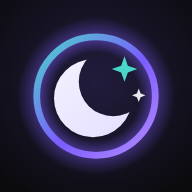
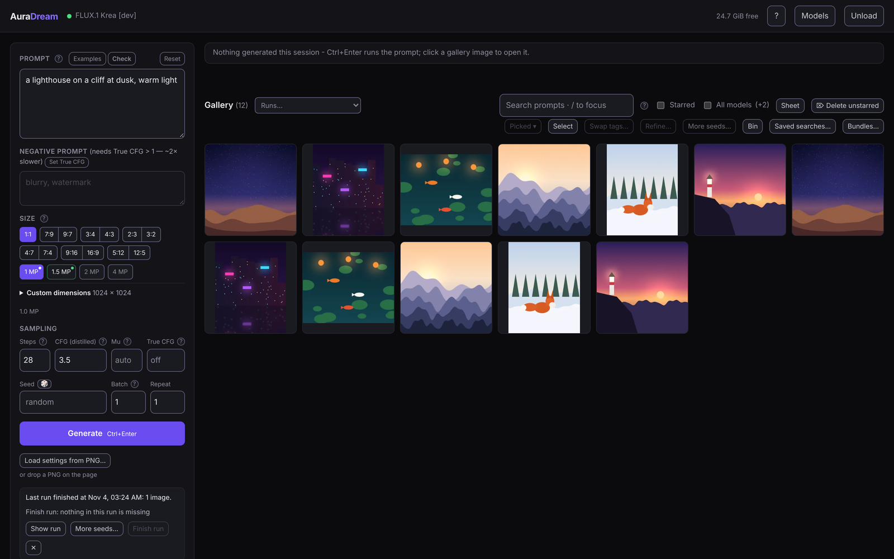
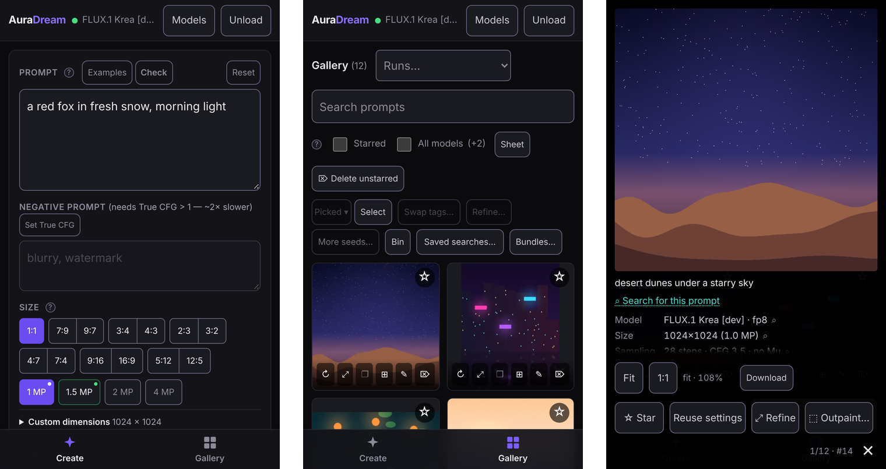
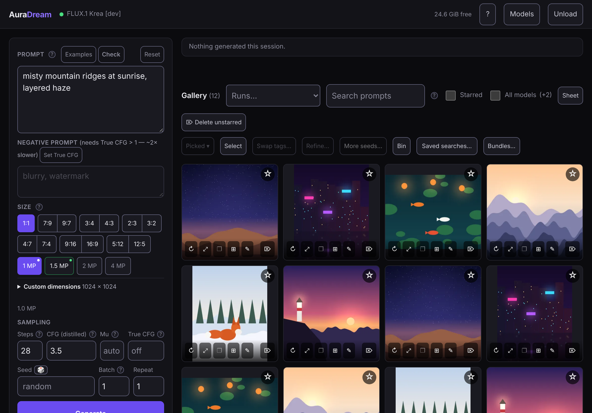

# AuraDream



Run text-to-image models locally with a browser UI, live previews and a searchable
gallery. Supports FLUX (FLUX.1, FLUX.2 [klein] and FLUX 3 [Klein]), Krea 2,
Z-Image, Qwen-Image, ERNIE-Image and a range of anime checkpoints. Built with FastAPI, diffusers, vanilla JavaScript and SQLite;
the frontend has no build step.

[First-time setup](docs/setup.md) · [Quick start](#quick-start) · [Usage guide](docs/usage.md) ·
[Anime model guide](docs/anime-model-guide.md) · [GPU measurements](docs/verified.md) ·
[Product design](docs/design/README.md)

**On Windows, start with [Easy install](docs/setup.md#easy-install): extract the ZIP, then double-click `install.cmd`.**



The screenshots come from the test server (`tools/fake_server.py`), so the
pictures in them are drawn stand-ins, not model output.

## Requirements

- **Windows 11**, **WSL 2** on Windows (needed for Nunchaku there), or
  **native Linux** as a server other PCs on the network open; all three
  tested. Native Linux was measured on Ubuntu 26.04 with an 8 GB RTX 3070
  ([its section](docs/verified.md#rtx-3070-8-gb-native-ubuntu-2026-11-03)).
  macOS is not supported.
- **NVIDIA GPU**, RTX 20 or GTX 16 series or newer, with a driver supporting
  **CUDA 13.0 or higher**. AMD, Intel and older NVIDIA cards are unsupported.
  The measured machines are an **RTX 5080 with 16 GB** on Windows and an
  **8 GB RTX 3070** on Ubuntu (Animagine XL 4.0 only on the latter).
  The default checkpoint needs more video memory than that 8 GB card;
  start with Animagine on a smaller card. See [GPU details](docs/setup.md#before-you-start).
- **System RAM:** the default FLUX.1 Krea [dev] used nearly 40 GiB of
  committed memory on the 64 GB test PC; RAM and the Windows page file must
  cover it. No 32 GB machine has been measured. SDXL anime checkpoints
  (Animagine, Illustrious, RouWei, NoobAI) need far less.
  [Measured memory figures](docs/verified.md#ram-at-the-load-the-fixed-loader-2026-10-27)
  explain the numbers and their limits.
- [uv](https://docs.astral.sh/uv/) (**the installer brings Python 3.13**).
- Disk space: about **32 GiB for the default model's weights**, and more
  besides. Some checkpoints also need a converted copy; Illustrious, WAI
  and RouWei each use about 14 GB for the source and conversion together.
  uv's package cache, `.venv` and the optional critic (about 4.9 GB) add
  more; [Before you start](docs/setup.md#before-you-start) totals them.

## Quick start

On Windows, the easiest route is the installer: download and extract the ZIP,
or clone the repository, then double-click **`install.cmd`** in its folder. It checks the
driver, card and memory, installs uv and Git if missing, asks where model
downloads go, installs the packages, makes Start-menu and desktop shortcuts
and offers to start AuraDream; it never downloads model weights
([Easy install](docs/setup.md#easy-install)). **`update.cmd`** updates it
later. The shortcuts run `bin\auradream.cmd --open`, which opens the page
in your browser once the server is ready.

New to this, or rather do it by hand? [First-time setup](docs/setup.md)
walks through it step by step, from the GPU driver and installing uv to a
first image, with fixes for common first-run problems. The short version,
from the repository root:

```powershell
uv sync
```

The default, **FLUX.1 Krea [dev]**, requires accepting the terms on its
[Hugging Face page](https://huggingface.co/black-forest-labs/FLUX.1-Krea-dev)
and signing in. From the AuraDream folder, run:

```powershell
uv run hf auth login
```

Press **Enter** for **Log in with your browser**, then open the URL it shows
and enter its code. No copied token is needed. **Paste an access token** is
the fallback: create a **Read** token at
[Hugging Face settings](https://huggingface.co/settings/tokens); pasted input
stays hidden. On Windows you can instead stop AuraDream, double-click
`install.cmd` again and answer **y** at the Hugging Face step.
[Setup step 6](docs/setup.md#6-sign-in-to-hugging-face-gated-checkpoints-only)
covers expired codes and renewing the sign-in.

Then start the server:

```powershell
uv run python -m backend.main
```

The server starts without terminal questions and restores your saved choices.
On a fresh visit without a saved or explicit checkpoint and without a Hugging
Face sign-in, Models suggests the open **Animagine XL 4.0**, matching the installer.
Open **<http://127.0.0.1:7860>**, choose a checkpoint and loading settings under
**Models** and press **Switch & load**, which also saves the choice for the
next start, then enter a prompt, choose a size and press **Generate**. Steps, CFG and Mu start at the selected checkpoint's defaults.
The first generation downloads and loads the weights: Animagine is about
6.5 GB; FLUX.1 Krea [dev]'s 32 GiB takes about 45 minutes at 100 Mbit/s.
Later loads reuse the cache. Starting the server alone does not load the
model unless preload is enabled. To
update or remove AuraDream, see [Updating](docs/setup.md#updating) and
[Uninstall](docs/setup.md#uninstall).

Open checkpoints need no login. Select one in the menu, or pass its id:

```powershell
uv run python -m backend.main --model cagliostrolab/animagine-xl-4.0
uv run python -m backend.main --model Minthy/RouWei-0.8   # epsilon release
uv run python -m backend.main --model Laxhar/noobai-XL-Vpred-1.0
uv run python -m backend.main --model circlestone-labs/Anima@aesthetic-v1.1
uv run python -m backend.main --model Gazingstars123/Anima-2.9B
uv run python -m backend.main --defaults   # ignore saved browser choices
uv run python -m backend.main --menu       # optional terminal picker
uv run python -m backend.main --model krea/Krea-2-Turbo --quant int8 --offload model
```

Krea 2 Turbo and Raw require **manual approval** on their Hugging Face pages.
Explicit flags override environment values, which override saved browser choices;
otherwise the app uses its defaults. To change checkpoints while the server stays
open, choose **Models**, select a checkpoint, quantization and offload, and press
**Switch & load**. The picker opens automatically on a fresh browser visit when
the idle server needs a model loaded. Compact facts show style, Refine support,
recorded speed and
upper MP guidance, labelled as a recommendation, documented/native maximum or
example size. Star models to keep favourites at the top of the
list; favourites are kept with the gallery on the server, so every
browser and device reaching it shares them. Loading options have visible
explanations. Speed categories use earlier RTX 5080 samples and label different
setups as references. Finish
or cancel queued/running jobs first, and wait for any load, prompt check, critic
or Expand request to finish. The current weights are released before the next
model loads; a first use can download weights and take several minutes.
Your prompts and saved images remain, and the controls and gallery follow the
selected checkpoint. **Apply & save** selects changed settings without loading
weights; an unchanged selection stays loaded. Both buttons remember the choice
in `auradream.settings.json` beside the gallery database. Save **Load
automatically on startup** to preload next time; leave it unchecked to open
quickly and load on demand. Nunchaku and its weight-format choices require Linux (native or WSL).
The full
catalogue is in [backend/launch.py](backend/launch.py).

`--open` opens the page in the default browser once the server is
listening; a second start while one is running just opens the page.
To start from a terminal in any folder, add `bin\` to your user PATH
(optional: the installer's shortcuts already start it). `auradream` runs
the command above; `auradream-wsl` runs `wsl/serve.sh` in WSL 2 (see
below). Both pass their arguments through, e.g. `auradream --menu`.
From PowerShell they run as `.ps1` scripts (allowed under the `RemoteSigned`
policy), so Ctrl-C stops the server without asking; from cmd.exe the `.cmd`
versions run and Ctrl-C asks "Terminate batch job (Y/N)?".

Each anime checkpoint (RouWei, NoobAI, the Anima variants and the rest) has its
own defaults, sizes and prompt habits, and some convert on CPU at first load; the
[anime model guide](docs/anime-model-guide.md) compares them, and
[card measurements](docs/verified.md#checkpoints) record their memory and timing.

For everyday use:

- **Examples** and the **?** hints explain the selected model's prompting and sizes.
  **Check** flags prompt issues; the optional local critic suggests revisions.
- **Batch** makes several images together; **Repeat** runs batches sequentially.
  **Grid search** varies settings, prompts and seeds, with resume support.
- Star favourites, reuse settings and compare images in the gallery or a contact
  sheet; in the full view, compare a pass with its source or an image with its
  CFG neighbours. PNGs retain their generation settings: drop one on the
  page (or an A1111, Forge or Civitai PNG) to load them into the panel.
- **Select** picks gallery cards to act on together: re-render them at another
  size, swap tags, refine, make more seeds, or star, unstar or bin them at once.
- **Ctrl/Cmd + Enter** generates; inside Grid search or Refine, it runs that action.
- **/** focuses gallery search outside fields, menus and dialogs. **M** opens
  More seeds for the focused image's batch; review it and press Queue separately.

See the [usage guide](docs/usage.md) for these workflows, keyboard shortcuts,
search syntax and gallery maintenance.

## Phones and tablets

The GPU PC makes the images; a phone or tablet on the same trusted network
opens its page. Follow [From a phone (Windows)](docs/setup.md#from-a-phone-windows)
or the [native Linux server](#native-linux-a-server-on-your-network) recipe.
On touch the page splits into Create and Gallery views with a tab bar;
the lightbox, long-press menu and pinch zoom work by finger. Added to an
iPhone's home screen, it opens in Safari under AuraDream's icon.



<details>
<summary>On an iPad (landscape)</summary>



</details>

## Run under WSL 2 (4-bit Nunchaku)

Nunchaku uses pre-quantized models and Linux-only kernels. From the repository
root in a **WSL shell**:

```bash
bash wsl/setup.sh                 # once: Linux environment and CUDA check
source wsl/env.sh                 # in every new shell
bash wsl/serve.sh                 # restores saved browser choices; no terminal prompts
```

Use the same <http://127.0.0.1:7860> address in your Windows browser.
The WSL default is the Nunchaku Krea 2 Turbo checkpoint in NVFP4 format
(RTX 50 series). For RTX 20–40, set
`export AURADREAM_NUNCHAKU_FORMAT=int4` before setup/sourcing the environment.
The menu lists the available pre-quantized checkpoints. Keep model offload
enabled on a 16 GB card.

**Source `wsl/env.sh` before any project `uv` command in WSL.** It keeps the
Linux virtualenv separate from Windows's `.venv`, and gives WSL its own gallery
under `~/auradream` (an existing `~/local-diffusion` stays in use). Keep the
gallery and model cache on the Linux filesystem. Maintenance commands act on that shell's gallery; Git Bash is not WSL.
If setup installs uv, follow its printed instruction to add uv to the current shell.

Nunchaku mode downloads and runs Hugging Face kernels. An explicit
`DIFFUSERS_TRUST_REMOTE_KERNELS=false` disables that permission. See the
[WSL design notes](docs/design-notes.md#nunchaku-lite-pre-quantized-repos-linux-only)
for details.

## Native Linux (a server on your network)

A Linux PC with an NVIDIA card can run AuraDream as a systemd user service
that other PCs on the network open in their browsers. It needs the
distribution's NVIDIA driver with CUDA 13.0 or higher (no CUDA Toolkit).
From a clone, as your own user (never under sudo):

```bash
bash linux/setup.sh               # once: driver and card checks, uv, Python 3.13, uv sync, the doctor
bash linux/install-service.sh     # write, enable and start ~/.config/systemd/user/auradream.service
sudo loginctl enable-linger $USER # start at boot and keep running with nobody logged in
```

`install-service.sh` writes the service's settings once, to
`~/.config/auradream/auradream.env`, and never rewrites it: edit it, then
`systemctl --user restart auradream`. It sets `AURADREAM_HOST=0.0.0.0` and
`AURADREAM_ALLOWED_HOSTS` to the names and addresses the machine had then,
for example `127.0.0.1,localhost,my-box,my-box.local,192.168.1.20`. Keep
`127.0.0.1` (and `localhost`) in that list (a second start, the doctor and
the CLI ask the server at `127.0.0.1`, and without it they take AuraDream
for another program), write the other names exactly and in lowercase,
as browsers send them, and use no wildcards: `*.local` loads the page and
then refuses every change it asks for. The script prints the addresses to
open; a firewall needs the port allowed (`sudo ufw allow 7860/tcp`).

While a job, a load, a switch, a gallery bundle or the critic's download
runs, and for `AURADREAM_KEEP_AWAKE_IDLE_MINUTES` (20) after the last request
someone made, the server holds the PC awake with `systemd-inhibit`, so an
idle suspend does not cut a render short; the page's own timed polls do not
count, so an open, idle tab lets it sleep. `/api/status`'s `keep_awake`
says whether it holds and why ([usage](docs/usage.md#keep-the-pc-awake)).
On Windows the same reasons hold a power request, which keeps the idle
sleep timer waiting.

```bash
journalctl --user -u auradream -f   # its log
bash linux/update.sh --restart      # stop it when idle, update (git pull --ff-only, uv sync), start it again
bash linux/install-service.sh --uninstall
```

`bash linux/control.sh status|start|stop|restart|logs|doctor` controls the
service there, and `bin\auradream-server` runs the same (and the update)
from a Windows PC over ssh, waking the server first
([From another PC](docs/setup.md#from-another-pc-auradream-server)).

The venv, the gallery and `auradream.settings.json` stay in the checkout,
as on Windows; this is a separate gallery from any Windows or WSL one.
[First-time setup](docs/setup.md#native-linux-a-server-on-your-network) has
the full route, including 8 GB cards and moving the downloads to another
disk. **The server asks for nothing until you set a passcode**
(`AURADREAM_PASSCODE` in the service's settings file; [Settings](#settings)),
and over plain http a passcode keeps out the household, not anyone who can
capture the network's traffic: only do this on a network you trust.

## Sizes

Choose an aspect ratio and a megapixel tier independently. Custom dimensions
must be multiples of 16 and fit the app's limits. Start with the selected
model's size hint: these presets are app limits, not quality guarantees for
every checkpoint. Author example sizes do not establish a supported maximum.

| | 1 MP | 1.5 MP | 2 MP | 4 MP |
| --- | --- | --- | --- | --- |
| 1:1 | 1024×1024 | 1248×1248 | 1440×1440 | 2048×2048 |
| 7:9 | 896×1152 | 1120×1440 | 1264×1632 | 1808×2320 |
| 9:7 | 1152×896 | 1440×1120 | 1632×1264 | 2320×1808 |
| 3:4 | 896×1200 | 1104×1472 | 1248×1664 | 1776×2368 |
| 4:3 | 1200×896 | 1472×1104 | 1664×1248 | 2368×1776 |
| 2:3 | 848×1264 | 1056×1584 | 1184×1776 | 1680×2496 |
| 3:2 | 1264×848 | 1584×1056 | 1776×1184 | 2496×1680 |
| 4:7 | 768×1344 | 960×1680 | 1088×1904 | 1552×2704 |
| 7:4 | 1344×768 | 1680×960 | 1904×1088 | 2704×1552 |
| 9:16 | 768×1360 | 928×1664 | 1088×1920 | 1536×2736 |
| 16:9 | 1360×768 | 1664×928 | 1920×1088 | 2736×1536 |
| 5:12 | 640×1536 | 800×1920 | 928×2224 | 1328×3168 |
| 12:5 | 1536×640 | 1920×800 | 2224×928 | 3168×1328 |

Direct generation allows up to 3168 pixels per side and 4,207,104 pixels total.
Changing resolution changes the composition even with the same seed.

## Refine

To enlarge an existing image while retaining more of its composition, open its
**⤢** dialog and choose **Refine**. The pass resizes the source and denoises it
partway; lower Strength preserves more of the original. Start with the model's
own default (0.4 on SDXL, 0.1 on FLUX.1 [dev]). A changed aspect ratio crops
the source. Refine is available only on compatible checkpoints and can exceed
the direct-generation size limit. See [Refine usage](docs/usage.md#refine-an-existing-image)
and [measured results](docs/verified.md) before attempting large passes.

## Inpaint and Outpaint

**Inpaint…** repaints only the part of a gallery image you paint a mask over;
**Outpaint…** extends its canvas past the edges and paints the new area. Both
keep the rest of the source pixel for pixel. Both run on the SDXL checkpoints, the
Z-Image family (Z-Image Turbo, Z-Anime) and FLUX.1 (Krea dev, dev, schnell);
FLUX.2 [klein] and Qwen-Image are not enabled yet. The mask is embedded in the
result's PNG, so the image alone reproduces it. [Measured](docs/verified.md#inpaint)
on WAI, Animagine, Z-Anime and FLUX.1 Krea dev (its inpaint only; the FLUX.1
outpaint has not been measured). See
[Inpaint](docs/usage.md#inpaint-part-of-an-image) and
[Outpaint](docs/usage.md#outpaint-an-image).

## Headless

Generate without a server or browser, using the same backend and gallery:

```powershell
uv run python -m backend.generate "a lighthouse in fog"
uv run python -m backend.generate "a lighthouse in fog" --aspect 16:9 --mp 1.5 --runs 4 --seed 42
uv run python -m backend.generate --help
```

The CLI loads its own weights. Unload the browser server's model first if it
holds the GPU. See [command-line usage](docs/usage.md#generate-from-the-terminal) for grids,
refinement, PNG settings, dry runs and exit codes.

## Settings

Set environment variables before starting the server or CLI. Paths below are
relative to the repository unless overridden; WSL uses its separate defaults.
Before the rename from Local Diffusion (2026-10-27) these were
`LOCAL_DIFFUSION_*`; those are no longer read, and the server names any still
set in a start-up warning.

| Variable | Default | Purpose |
| --- | --- | --- |
| `AURADREAM_MODEL_ID` | `black-forest-labs/FLUX.1-Krea-dev` | Checkpoint repository id |
| `AURADREAM_QUANT` | `fp8` | `fp8`, `int8`, `none` (bfloat16), or `nunchaku` (Linux, pre-quantized model) |
| `AURADREAM_OFFLOAD` | `model` | `model`, `sequential` (less VRAM, slower), or `none` |
| `AURADREAM_DEVICE` | `cuda` | GPU device; e.g. `cuda:1` for the second card |
| `AURADREAM_PRELOAD` | `false` | Load weights at startup |
| `AURADREAM_OUTPUTS_DIR` | `outputs/` | Generated PNGs |
| `AURADREAM_DB_PATH` | `auradream.db` (or an existing `local-diffusion.db`) | Gallery database |
| `AURADREAM_BUNDLES_DIR` | `bundles/` beside the database | Saved gallery archives; independent of images and database |
| `AURADREAM_LORAS_DIR` | `loras/` | `.safetensors` adapters |
| `AURADREAM_MAX_BATCH_PIXELS` | `12902400` | Pixel budget per pipeline call |
| `AURADREAM_MAX_GRID_IMAGES` | `1024` | Image limit for a grid |
| `AURADREAM_HOST` | `127.0.0.1` | Bind address |
| `AURADREAM_PORT` | `7860` | Server port |
| `AURADREAM_ALLOWED_HOSTS` | `127.0.0.1,localhost` | Allowed hostnames/IPs; include the browser's destination when exposing the server on a LAN, keeping `127.0.0.1` and `localhost`; exact lowercase names, no wildcards |
| `AURADREAM_ALLOWED_ORIGINS` | empty | Extra exact browser origins for a proxy on another port, for example `https://dream.home.arpa`; its hostname must also be allowed above ([HTTPS](docs/setup.md#https-for-a-phone)) |
| `AURADREAM_SSL_CERTFILE` / `AURADREAM_SSL_KEYFILE` | unset | Existing PEM certificate and private key for direct HTTPS; set both and trust the issuing CA on each client ([recipe](docs/setup.md#https-for-a-phone)) |
| `AURADREAM_PASSCODE` | unset | A passcode the page and every other caller must give, asked whenever the server can be reached beyond this machine (`AURADREAM_HOST` or an allowed host that is not loopback); at least 8 characters, from the environment only; see below |
| `AURADREAM_LOG_LEVEL` | `INFO` | Server and uvicorn logging; on the console `DEBUG` includes tracebacks, which `auradream.log` beside the database receives at every level |
| `AURADREAM_CRITIC` | `true` | Enable the optional local prompt critic |
| `AURADREAM_CRITIC_SERVER` | unset | Use a local compatible `llama-server` binary |
| `AURADREAM_CRITIC_MODEL` | unset | Use a local `.gguf` instead of downloading the pinned critic model |
| `AURADREAM_KEEP_AWAKE` | `true` | Hold the PC awake while AuraDream is busy: `systemd-inhibit` on Linux, a power request on Windows |
| `AURADREAM_KEEP_AWAKE_IDLE_MINUTES` | `20` | Minutes to keep holding after the last request someone made (the page's timed polls are not one); `0` holds only while busy |
| `AURADREAM_IDLE_UNLOAD_MINUTES` | `0` | Opt-in model release after idle minutes; waits for work to finish, ignores timed page polls, and works with keep-awake off |

**Without `AURADREAM_PASSCODE` the server asks for nothing.** Anyone who can
reach it can read every prompt and image, delete or import galleries, and
make the machine download checkpoints with your Hugging Face token. Keep the
default loopback address unless the network is trusted.

With `AURADREAM_PASSCODE` set, a server reachable beyond this machine shows
a sign-in page and refuses everything else until the passcode is given; the
browser on the PC itself signs in once too. Know what it is and is not:

- Over plain http the passcode, its cookie and every prompt and image cross
  the network unencrypted. Anyone who can capture that network's traffic
  reads all of it and can sign in afterwards.
- So the passcode keeps out people who can merely reach the address: the
  household, a guest on the Wi-Fi. It is not protection on a network you do
  not trust, and never a reason to forward the port to the internet.
- HTTPS encrypts the traffic; use the [phone recipe](docs/setup.md#https-for-a-phone)
  or a VPN (see
  [the usage guide](docs/usage.md#scripting-the-running-server) for the
  proxy's host and port).
- Do not reuse a password from anywhere else. The passcode sits in plain
  text in the environment (on Linux, the service's settings file).
- There is one passcode and no accounts. Changing it and restarting signs
  every device out; nothing else does. **Sign out** in the Models panel
  signs out the browser it is pressed in. A browser stays signed in for
  thirty days after its last visit, across restarts and updates.

Set it in the environment only (never a flag or the saved settings); the
server will not start with fewer than 8 characters. After five wrong
passcodes in a row every further try waits, up to a minute, for everyone
not yet signed in. `generate --via-server`, the doctor and the Linux
scripts send the passcode from `AURADREAM_PASSCODE` in their own
environment.

Custom critic binaries must support the pinned server's flags and authentication;
see the [critic design notes](docs/design-notes.md#the-prompt-analyser).
All settings are defined in [backend/config.py](backend/config.py).

## Output

Full-size PNGs go to `outputs/`; gallery previews go to `outputs/thumbnails/`,
so you can select and copy a batch of originals without the previews mixed in.
Existing indexed thumbnails move into that subfolder on the next app startup;
refresh any open browser tabs afterwards. To filter originals in File Explorer,
search the output folder for `*.png`.

**Bundles…**, at the end of the row under the gallery's search box, opens
the Gallery bundles dialog: it saves all images and the gallery database
in one verified ZIP, optionally encrypted with a password, either as a
backup that keeps the gallery or as a bundle that then clears it. **Back up
(keep gallery)** also bundles just the picked or the starred images, to keep
or to give to someone. Download a saved bundle or import
one to merge its images, favourites and timings into the current gallery.
See [gallery bundles](docs/usage.md#gallery-bundles).

`auradream.db` indexes the gallery. Each PNG
contains its generation settings in an `auradream` JSON chunk and an
A1111-style `parameters` block; see
[load settings from a PNG](docs/usage.md#load-settings-from-a-png).
Back up **both the PNGs and database** to retain
favourites, timings and the recycle bin. Deleting an image in the browser
moves it to the recycle bin, where it can be restored until the bin is
emptied. See [gallery maintenance](docs/usage.md#clear-or-recover-a-gallery)
for the recycle bin, clearing history, rebuilding a lost index or importing
another gallery.

## Development

```powershell
uv run --group dev pytest
uv run --group dev ruff check .
uv run --group dev python tools/typecheck.py
```

Tests use fake pipelines and a temporary gallery: no GPU or weight downloads.
Node is required for the script-scope and pinned Pyright checks.
For a browser smoke check, run the fake server and browser driver in separate
terminals (requires Node 22+ and Edge or Chrome):

```powershell
uv run python tools/fake_server.py --fresh
node tools/browser.mjs tools/smoke.json
```

Checkpoint and feature smoke recipes are in [AGENTS.md](AGENTS.md#tests).
GPU validation is recorded separately in [docs/verified.md](docs/verified.md).
Static frontend edits need no server restart; backend edits do.

## Documentation

- [First-time setup](docs/setup.md): from a fresh machine to a first image, step by step.
- [Usage guide](docs/usage.md): prompts, batches, grids, gallery, CLI and recovery.
- [Anime model guide](docs/anime-model-guide.md): choosing a checkpoint and its settings.
- [GPU verification](docs/verified.md): measured behaviour and remaining gaps.
- [Design notes](docs/design-notes.md): implementation decisions and model sources.
- [Module map](docs/rules.md#layout): what every source file is responsible for.
- [Refactor audit](docs/maintainer/source-audit.md): the file splits and why the long files stay whole.
- [Maintainer records](docs/maintainer/README.md): plans, reviews, checklists and testing runbooks.
- [Documentation index](docs/README.md).

## Contributing and security

See [CONTRIBUTING.md](CONTRIBUTING.md); [AGENTS.md](AGENTS.md) is the
contributor guide for humans and coding agents alike. Report vulnerabilities
privately as described in [SECURITY.md](SECURITY.md).

## Licence

The code is licensed under the [Apache License 2.0](LICENSE). Portions adapted
from diffusers, BasicSR and Real-ESRGAN keep their notices; see [NOTICE](NOTICE)
and [LICENSES/](LICENSES). Quoted prompting guidance in `backend/guides.py`,
`backend/prompt_sources.py` and `docs/` remains its cited authors' words.

No model weights are distributed. Each checkpoint is downloaded from its own
source under its own licence, which you accept there: FLUX.1 [dev] and
FLUX.1 Krea [dev] are non-commercial, Krea 2 is gated, and the anime
checkpoints carry their authors' own licences and use restrictions. Consult
the selected model's terms. WAI is fetched from an unofficial community mirror; use the
[author's permissions](https://tensor.art/models/990778216270553015/WAI-illustrious-v17)
rather than the mirror's metadata.

AuraDream is not affiliated with or endorsed by Black Forest Labs, Krea,
or any checkpoint's authors.
