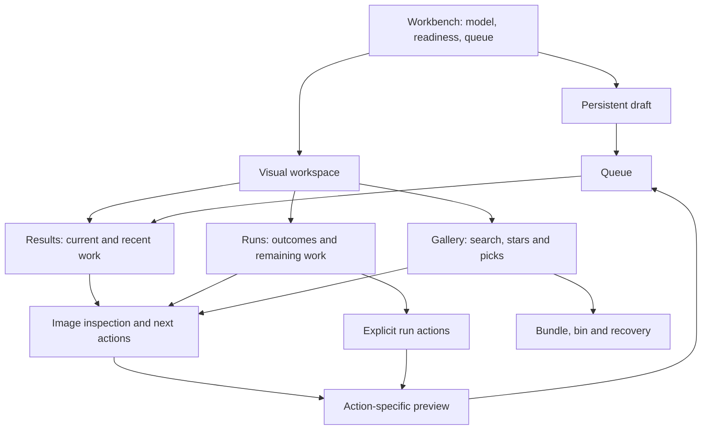

# Workbench design

**2026-10-18 · proposed whole-app interaction design.** Audience and evidence
are in [the brief](README.md) and [research](research.md). Testable outcomes
live in [requirements](requirements.md); alternatives and trial methods in
[validation](validation.md). This specifies a candidate, not today's UI.

## Design principles

1. Keep the image and the next useful action close together.
2. Keep Matt's draft separate from the work he is inspecting.
3. State the target before the cost, and the cost before Queue.
4. Preserve the difference between making new work and finishing old work.
5. Let the server decide eligibility, seeds, expansion and admission.
6. Prefer remembered context and reversible actions to extra confirmation.
7. Show uncertainty honestly: sourced advice, heuristic advice, measured
   performance and unmeasured behavior remain distinguishable.

These extend existing choices rather than introducing a guided wizard.
The proposed shared workspace must earn its space in the task trials.

## Fast paths

Matt's explicit objective is to do common tasks quickly. These are initial
task candidates from existing work, not measured frequency rankings. Count
from the stated starting point and exclude generation/loading time. Avoid
adding a view change or generic action menu to an already direct path.

| Task and start | Interaction target | Preserve |
|---|---|---|
| Generate from a ready draft | One Generate press or existing Ctrl/Cmd+Enter | No new confirmation for ordinary Generate |
| Four more from the finished batch | More seeds, then Queue: two presses | Server preview and sensible retained Batch default |
| Inspect a result | One image press | Return to the same result and draft |
| Keep an inspected image | One Star toggle | One stable name with pressed state |
| Reuse inspected settings | One Reuse, with Undo at the draft | Explicit replacement and mismatch warning |
| Compare two candidates from unpicked cards | Two picks, Compare: three actions | Pair/difference labels; retained picks |
| Run an already configured experiment | Review existing preview, Run grid | Scope, total work and budget remain legible |
| Finish a stored interrupted run | Direct Finish entry and resolved submission | No grid rebuilding; original phase-2 holds and preview |
| Return from review focus | One toggle, draft intact | No re-entry or reconstruction |

First verify current action counts on the same fixtures. A proposed layout
that requires more steps on Matt's repeated loop must show a concrete benefit
and be revised if that benefit does not appear in his task trials. Keyboard
shortcuts supplement visible actions; no new More seeds key is proposed.

## Objects and vocabulary

The placement below is informed by all 129 explicit feature ratings.
The hierarchy is more specific; architecture and speed gains still need
task evaluation.

| Object | Meaning to preserve | Visible language |
|---|---|---|
| Draft | Current editable request, independent of inspected results | Draft / Settings |
| Checkpoint | Model selection shared by the server and all tabs | Current model; show quantization and readiness nearby |
| Job | One queued submission, with its lifecycle and outcome | Job when disambiguation matters; otherwise describe the work |
| Run | Existing run identity grouping related settings/cells and extensions | Run; never imply a new named project or folder |
| Cell | One resolved settings combination in a plan | Cell in experiments and recovery counts |
| Batch | Images generated together; also retained grouping used by More seeds | Batch with images-per-cell explanation in its preview |
| Image | A saved result with settings, lineage and optional star | Image, seed, source/pass where relevant |
| Picks | Explicit IDs retained across gallery searches and paging | N picked, M hidden by this view |
| Filter | Query plus checkpoint/star scope used to browse | Filter results, with readable active scope |
| Bundle | Verified archive with chosen records and images | Backup / Bundle and clear / Import, as current operations distinguish |

Do not change run IDs, reproduction metadata or persistence ownership to
implement this presentation. Persistent run-cell recovery remains the
[accepted phase-2 plan](../plan-continue-run.md#phases).

## Information architecture

**Persistent frame:** current checkpoint, quantization, readiness, Models,
and concise active-job/queue status. Full queue details open on request;
the current work's watch selector, progress and Cancel stay direct; queue
rows expose cancellation. Pause/Resume moves to secondary job controls,
while a genuinely paused job remains explicit and easy to resume. A pause retains
weights and blocks switching as today. Status is not a second competing
dashboard of statistics.

**Draft composer:** Prompt, applicable negative, size, sampling, seed,
Batch/Repeat, Generate and Grid search. Check/Tags/Examples remain by the
prompt. Existing less-used references and LoRA remain below the main loop.
Do not hide a control used every time merely because it is called advanced.

### Reported generation-control priorities

The [A1–A14 answers](preferences.md) now determine the next composer study:

| Placement | Controls | Intended effect |
|---|---|---|
| Primary | Prompt and applicable Negative | Direct authorship without opening a panel |
| Primary | Separate Aspect ratio and Resolution presets | Fast independent choices; no custom pixel entry required |
| Primary | Readable fixed Seed, Batch and Repeat | Deliberate starting seed and concurrent/sequential image count together |
| Primary | Generate and a separately placed Reset with Undo | Fast start and frequent return to defaults without an accidental reset |
| Secondary, one disclosure | Steps, CFG and applicable Mu; effective values in the summary | Occasional adjustment stays one press away |
| Secondary | Custom dimensions/orientation, True CFG, explicit random-seed choice | Keep access without occupying the frequent path |

No numeric seed, aspect ratio, megapixel tier, Batch, Repeat or sampling value
has been selected by this response. Keep illustrative values labelled in the
concept and preserve real user-owned values. A blank seed must not visually
pretend to be fixed. Matt confirmed that Reset keeps today's behavior,
including clearing Seed; he enters a seed afterwards. Preserve Reset's
existing scope and Undo without auto-filling Seed or adding a submission
guard. The fuller ratings below now guide prompt assistance, Grid search
and review/continuation placement as well.

The revised concept now separates Aspect/Resolution and Seed/Batch/Repeat,
shows a fixed illustrative seed, puts sampling in a disclosure, and models
Reset clearing Seed with Undo. Its WAI sample truthfully marks Mu unavailable.
It also exposes the frequent prompt helpers directly. The concept models
placement; it does not implement real tokenizers, tag lookup, critic work or
all of the application's Reset/persistence scope.

**Results:** newest submission and recent results for immediate judgment.
Show its outcome and continuation actions where it ends. Use the sheet
for a large comparison and a focused image for a keeper. Arriving results
do not move an existing control beneath the pointer, change gallery scope
or steal focus. Looking at old work does not replace the draft.

**Runs:** select a run, see its checkpoint and outcome, review its images,
or choose More seeds of this run. Once phase 2 exists, Finish run uses its
stored plan. Opening a run changes the workspace view only; it is not the
deferred Load into panel feature.

**Gallery:** retain existing checkpoint filtering, All models, Starred,
search, selection and paging. Cards and contact sheet are representations
of a scope, not separate libraries. Keep Bin and Bundles accessible at the
point where curation finishes. Do not silently introduce picks on a sheet;
that would reopen a documented decision.

### Reported whole-workflow priorities

The [fuller response](preferences.md) changes the original generic hierarchy:

| Surface | Direct/common controls | Secondary access |
|---|---|---|
| Draft | Existing confirmed A priorities; Prompt variables entry | Occasional numeric grids; unused axes/seed list/time budget |
| Prompt assistance | Examples, guide/help, Tags/autocomplete/chips and Check adjacent to Prompt | Token detail, corrections/Undo, critic/rewrite, shared-seed comparison and ERNIE Expand in context; PNG settings secondary |
| Active work | Progress/elapsed/estimate, job watching, queue, cancel, retry/reconnect and recent results | Optional live preview and Pause; expose any actual paused state |
| Gallery | Starred, All models, prompt search, Runs, picking, card size and Fit/Crop | Advanced search syntax; no default Gallery-beside-newest split |
| Image/sheet | Large inspection, facts, zoom, star, source comparison, Sheet and Fill width | CFG/swipe/side comparisons and sheet axis pinning; unused export |
| Actions | Reuse, Use seed, More seeds by batch/picks-filter/run; Re-render, Swap tags and Mass refine with scope counts | Recorded-reference reuse remains contextual; unused cross-model mass inclusion |
| Archive | Whole-gallery backup, password, verified Bundle and clear, Download and Import | Picked/starred archive scopes |
| Models | Favourites, guide/example/timing facts, auto-load preference and model selection | Quantization/offload, save-without-load and manual weight operations |
| Input | Keyboard, right-click and Ctrl/Shift selection | Terminal workflows outside the primary browser layout |

Prompt variables have their own entry near authoring; an occasional Grid
workflow must not bury that frequent action among unused axes. Grid's
review/count and Resume remain easy to find. Budget controls remain supported
without driving the default run story or leading validation task.
The direct entry opens variable authoring and its Grid preview; Run grid
still performs substitution. Plain Generate does not acquire a new expander.

The Gallery view uses the workspace instead of sharing it with the newest
result: E11 names that existing split view, not the separate question of a
composer beside Gallery. Show large facts/inspection and sheets as
representations of the selected scope; do not add another mandatory stage.

Never-use answers reduce prominence rather than remove capabilities. In
particular, unneeded manual LoRA/reference authoring must not discard
recorded inputs when G3 reuses references. Never-random Generate does not
restrict the frequently used More seeds paths. The latest B response directly
supports the prompt-assistance placement above; it does not justify adding
a forced check or critic step before Generate.

**Inspector:** one hierarchy for the inspected image's identity, prompt,
important settings, source/pass lineage, and actions. Full view keeps zoom,
pan and existing source/CFG comparisons. At widths where a side inspector
would compress the picture, details go below or open explicitly in a
dialog. The concept uses below-image detail to test this lower-density case.

## Layout and visual direction

Retain the app's dark neutral surfaces, restrained purple primary action,
teal focus indicator and amber stars/warnings. Reuse the `web/style.css`
tokens; do not create an unrelated brand system. Use typography, spacing
and placement to establish order before adding borders or colored badges.
Reserve accent fill for the principal action in a local group. State must
also be readable in words, never only color or a dot.

The proposed desktop hierarchy is a shallow global status row, draft on
the left, and a dominant visual workspace to its right. Within the
workspace: view choices, scope/outcome, images, then contextual detail.
Counts and action names should scan without reading the entire settings
list. Long prompts and rare options expand explicitly.

| Window context | Design contract |
|---|---|
| 2560×1305 and 2048×1040 at 125% | Preserve large images; test adjacent detail against below-image detail; use existing wide-tier scale rules |
| 1920×947 and 1400×900 | Two columns if they fit; secondary detail stacks; the primary action and active-job controls remain reachable |
| 1536×864 or shorter desktop | Avoid solving progress visibility with a new overlay over Generate; use persistent status and explicit details; since UI#8 (2026-10-20) 1536×864 fits a running batch; shorter does not |
| ≤900 CSS px | One document column, wrapping tools; no compulsory side panel or independent settings scroller |
| 200% zoom, long labels/prompts | Reflow controls; preserve semantic reading order and visible focus; allow genuine image/sheet panning rather than clipping controls |

These are evaluation contexts, not permission to change current CSS below
1800 px as part of a wide-only patch. A future app layout change must be an
explicit scoped implementation with its browser smokes. The documentation
prototype has its own isolated stylesheet and does not load app scripts.

## Interaction contracts

### Draft and inspection

Changing Results/Runs/Gallery, filtering, opening an image, or selecting a
run preserves the draft. Reuse is the explicit transfer: identify the source,
explain changed checkpoint or unavailable dependencies, and offer the
existing undo. Reusing a pass reopens its appropriate dialog, as today.
Reset, examples, rewrites and imported PNG settings retain undoable writes.
In-flight suggestions cannot overwrite text Matt typed while waiting.

Checkpoint changes preserve prompts, apply checkpoint-specific supported
controls/defaults and update eligibility. Old-image facts continue to name
their original checkpoint. A foreign image is inspectable; generation from
it must explain the required model rather than silently switching or mixing.

### Action scope

Use one consistent scope sentence pattern across previews without changing
the underlying semantics. Examples are illustrative copy, not computed UI:

| Entry point | Scope sentence | Essential consequence |
|---|---|---|
| Image More seeds | This image's batch · 1 cell · 4 more images | Continue its batch, join its run |
| Run More seeds | Entire run · 6 cells × 4 = 24 more images | Ignore Starred; count every live batch of the run |
| Footer with picks | 3 picked images · 1 hidden by this view | Keep chosen IDs; group/count per action |
| Footer without picks | Current filter · 28 images | Show model/star/search scope; resolve on server |
| Bundle Starred | All starred images · all checkpoints | Does not inherit current gallery search |
| Sheet | Images under the gallery query | Does not become a picked-only sheet |

The preview states included/eligible counts, exclusions and their reasons,
changed parameters, destination run behavior, total new work and estimate
limits. A More seeds count is per cell and may exceed picked-image count.
Do not claim a fixed count before the server has resolved it.

Queue uses the reviewed answer and revalidates against changed gallery/model
state. A stale preview refreshes and explains its change; it never silently
queues a different target or amount. Keep the accepted More seeds dialog
even for a trivial batch. A held action is focusable, `aria-disabled`, titled
with its reason and explains that reason on activation, subject to the
existing documented exceptions.

### Continue and recover

- **Resume** unpauses an existing live job. It preserves that job's place.
- **More seeds of this batch/run** makes new images with existing settings;
  its server-selected seeds skip held/planned ones and join the run.
- **Resume the remaining N cells** is current phase-1 recovery vocabulary.
- **Finish run** replaces the missing-cell controls only with phase 2; it
  uses stored cells independent of the composer, reload or server restart.
- **Retry** keeps its documented failure behavior. Do not merge these verbs
  into one ambiguous Continue button.

Phase-2 edge cases remain owned by the feature plan: **Finish stays held while
the run has work queued**, saying which job already holds the rest; stored-plan availability
for legacy/imported runs; duplicate queued cells; binned cells held as done;
permanently deleted cells eligible to redraw with an explicit count; absent
source/mask/adapter; original budget; checkpoint/quantizer mismatch. A
bundle-and-clear removes the run from the working gallery; import restores
what the archive contains. This design does not invent archive-wide search.

### Judge, edit and keep

Source/pass and CFG comparison stay available. The proposed Compare picked
uses exactly two explicit images, labels their differences and states when
size/model/seed changes prevent an otherwise controlled comparison. It
does not claim why an image is better. Preserve selection and return context.

Refine changes the whole pass, Inpaint changes a painted region while
compositing over its source, and Outpaint extends the canvas with an overlap
band. Explain the operation and changed/preserved region before Queue.
Keep their dedicated dialogs, masks, measured recipes and capability limits;
a shared inspector is not a proposal for rebuilding a general image editor.
Result inspection provides the source comparison and the next edit/keep step.

Stars, picks and binning have distinct meanings: keep judgement, temporary
action target and recoverable removal. Per-image binning stays immediate;
permanent deletion/Empty bin retains explicit confirmation. Partial bundles
must not auto-include unchosen dependencies: explain omissions and let Matt
choose a fuller archive deliberately. Verification precedes source cleanup.

## State coverage

| Domain | States and required presentation |
|---|---|
| Model | Selected/unloaded, loading/download, ready, gated/failed, switch refused, changed elsewhere; state plus next remedy |
| Queue | Waiting for model/job/helper, queued, running, pause requested, paused, cancelling; identify what is waiting and why |
| Outcome | Done, budget stop, failure/partial, cancellation, no images; retain saved result count and applicable next actions |
| Connectivity | Offline with draft retained; reconnect to ongoing job; restarted server; work from another tab |
| Run | Complete, missing, remainder queued, no stored plan, foreign checkpoint, changed quantizer; never infer from currently visible images alone |
| Image | Direct/pass, source available/binned/missing, dependency unavailable, binned/deleted result; distinguish missing file from disconnected server |
| Preview | Resolving, valid, stale, no eligible images, cap exceeded, unknown estimate; explain before enabling commitment |
| View | Empty gallery, empty filter, hidden picks, long prompt, many cells, image failure, comparison, keyboard focus and zoom |

Use local, persistent feedback for a refusal or changed preview. Polite
announcements cover completed actions and changed scope, rather than every
progress frame. A modal owns focus and Escape; closing returns to its opener
or a sensible surviving control. Never scroll the page or take the caret
merely because work arrived or a status poll changed.

## Accessibility design acceptance

Keep semantic landmarks, labels, visible focus and keyboard paths through
the critical loop. Provide essential actions without hover or right-click.
Sheet roving-grid work remains UI#4; browser keyboard, forced colours and
reduced motion checks are UI#9, and hands-on screen-reader/touch qualification
remains UI#7. Do not call accessibility-tree checks complete
assistive-technology validation.

Use WCAG 2.2 as a review reference: keyboard focus must not be entirely
covered by authored content, and small targets need sufficient size or
spacing under the criterion's exceptions ([focus visibility](https://www.w3.org/WAI/WCAG22/Understanding/focus-not-obscured-minimum.html),
[target sizing](https://www.w3.org/WAI/WCAG22/Understanding/target-size-minimum.html),
consulted 2026-10-18). Aim for comfortable touch targets in touch contexts;
24 CSS px is the criterion's minimum-size basis, not a blanket requirement
that every dense control be 44 px. These references are design inputs, not
a claim of WCAG conformance. The related usability review uses
[visibility, control, consistency and error-prevention heuristics](https://www.nngroup.com/articles/ten-usability-heuristics/)
as evaluation prompts, not evidence of Matt's actual behavior.
